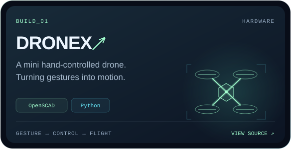
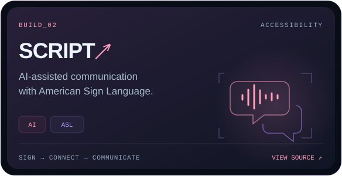

  <picture>
    <source media="(max-width: 600px)" srcset="./assets/hero-mobile.svg" />
    
  </picture>

  
  
  

I’m **Geo Armstrong** — **@Darkreader404** · **he/him**. Exploring code, human-centered ideas, and market signals. My builds include a hand-controlled drone and an AI-assisted ASL communication project.

### Selected builds

  
  

[**DRONEX ↗**](https://github.com/Darkreader404/DRONEX) · Gesture-controlled hardware &nbsp; / &nbsp; [**SCRIPT ↗**](https://github.com/Darkreader404/SCRIPT) · AI &amp; accessible communication

### Contribution signal

<a href="https://github.com/Darkreader404?tab=overview">
  <picture>
    <source media="(max-width: 600px)" srcset="./assets/contributions-mobile.svg" />
    
  </picture>
</a>

### Activity pulse

<a href="https://github.com/Darkreader404?tab=overview">
  <picture>
    <source media="(max-width: 600px)" srcset="./assets/activity-mobile.svg" />
    
  </picture>
</a>

  <a href="https://github.com/Darkreader404?tab=repositories">All repositories</a> &nbsp; · &nbsp;
  <a href="https://github.com/Darkreader404">Find me on GitHub</a>

  

